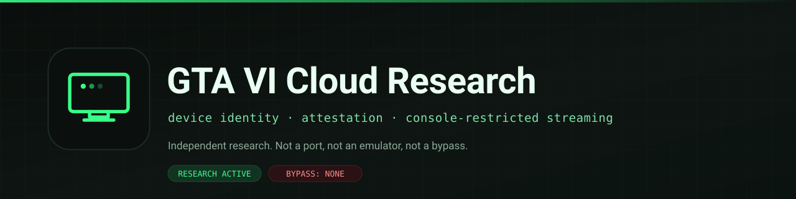
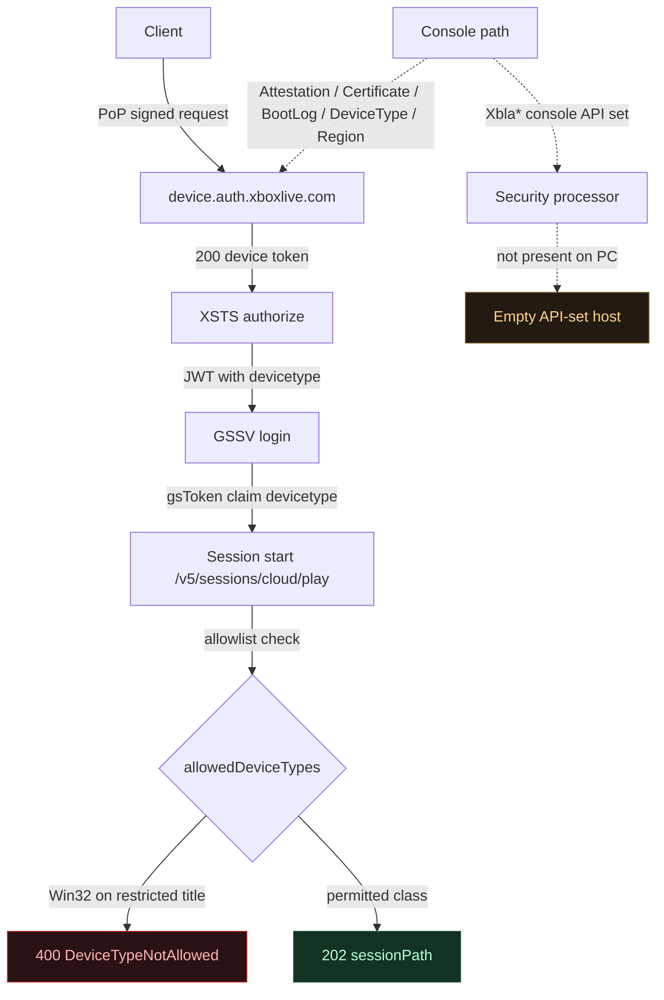

 

**Investigating Xbox Cloud Gaming console authentication, device identity, and console-restricted streaming on PC.**

<a href="#current-status">Status</a> ·
<a href="#what-were-investigating">Scope</a> ·
<a href="#major-discoveries">Discoveries</a> ·
<a href="docs/README.md">Documentation</a> ·
<a href="ROADMAP.md">Roadmap</a> ·
<a href="community/how-to-help.md">How to help</a>

---

## What this is

Xbox Cloud Gaming runs the game on Microsoft's hardware and streams video to your device. Most titles stream to any supported browser or app. A small number of titles carry a **device allowlist** and will only start a session for specific device classes.

This project asks one question:

> **Can a PC be recognised as an authorised Xbox console by Xbox Cloud Gaming — without owning Xbox hardware?**

If the answer were yes, console-restricted titles such as **GTA VI** could be streamed on a Mac or PC. This is cloud-authentication research, **not** game emulation: the game would still execute on Microsoft's servers.

**Current result: no.** No working bypass, no accepted console-restricted session from PC.
This is not a GTA VI port, emulator or crack — the game would still run on Microsoft's servers. This repository documents what has been measured, what has been ruled out, and what remains unknown.

## Current status

| Track | State |
|---|---|
| Research understanding | **~47%** — subjective estimate, not a metric |
| Functional console impersonation | **0%** |
| GTA VI cloud gameplay on PC | **Not achieved** |
| Restricted title launched on non-console hardware | **Not demonstrated** |
| Evidence base | Local experiments + static analysis + public sources |

Progress is deliberately conservative. A `200` from device authentication, a catalogue listing, or a visible game card is **not** a working result. See [completion criteria](docs/current-status.md#completion-criteria).

## What we're investigating

- How Xbox Live decides a client's **device class**, and where that decision is enforced.
- What a real console sends during **device authentication** (certificate, attestation, boot log, PCR state, security-processor token).
- Whether any of that is reproducible **without** console hardware.
- Whether catalogue filtering, session authorisation and device identity are separate gates.
- What public research and open-source clients already establish — and what they only claim.

## Major discoveries

<table>
<tr><th>Finding</th><th>Evidence</th></tr>
<tr>
<td><b>Device allowlists are real and title-specific.</b> 
<code>KILLERINSTINCT2CLASSIC</code> → <code>XBOXONE, SCARLETT, SAMSUNGTV</code> 
<code>GRANDTHEFTAUTOVI</code> → <code>XBOXONE, SCARLETT</code></td>
<td>Locally tested</td>
</tr>
<tr>
<td><b>The refusal is device-class, not entitlement.</b> 
The same account, same headers: KI 2013 → <code>202</code> with a session path; KI 2 Classic → <code>400 DeviceTypeNotAllowed</code> before allocation.</td>
<td>Locally tested</td>
</tr>
<tr>
<td><b>Device type propagates through the token chain.</b> 
XSTS with a <code>Win32</code> device token produces <code>gsToken.devicetype = Win32</code>; Android/iOS behave the same way.</td>
<td>Locally tested</td>
</tr>
<tr>
<td><b>Console types need a matching hardware attestation.</b> 
The console branch is five fields, <code>TokenType: SP_JWT</code>, no <code>Signature</code> header. With a real attestation <code>Scarlett</code> → <code>200</code> (XCOS); the same attestation with <code>XboxOne</code> declared → <code>400</code>. The match is per model: an original Xbox One returns <code>200</code> for <code>XboxOne</code> with its own 1,208-char attestation. XCOS is an intermediate: XSTS rejects it, and only the locally converted JWE is evaluated.</td>
<td>Console capture (2026-11-21)</td>
</tr>
<tr>
<td><b>Console requests carry hardware-backed material.</b> 
The wire request is five fields — <code>Attestation</code> (744 B), <code>BootLog</code> (320 B), <code>Certificate</code> (1,024 B), <code>DeviceType</code>, <code>EffectiveRegion</code> — minted per boot by the security processor.</td>
<td>Console capture (2026-11-21)</td>
</tr>
<tr>
<td><b>The console provider does not exist on desktop Windows.</b> 
The <code>ext-ms-win-xblauth-console-l1-1-0</code> API-set contract maps to an <b>empty host</b> in stock Windows 11 23H2 ARM64/x64 schemas.</td>
<td>Verified (binary + schema)</td>
</tr>
<tr>
<td><b>Windows does perform device authentication — in a service.</b> 
A WinHTTP capture attributed an RPS <code>POST /device/authenticate</code> to <code>gamingservices.exe</code> (SYSTEM), returning an encrypted JWE token.</td>
<td>Locally tested</td>
</tr>
<tr>
<td><b>Desktop fields break the console request.</b> 
Adding <code>Nonce</code>, <code>SP_JWT</code>, <code>AuthMethod</code> or <code>ProofKey</code> to the console body turns its <code>200</code> into <code>400</code>.</td>
<td>Console capture (2026-11-21)</td>
</tr>
<tr>
<td><b>Catalogue gating is per offering, not per device token.</b> 
The <code>xgpuconsole</code> catalogue returns the same ≈2,865 titles (2026-11-20) with or without a <code>Win32</code> device token; <code>xgpuweb</code> no longer lists the console-only titles at all.</td>
<td>Locally tested</td>
</tr>
</table>

## Authentication architecture

Solid arrows are **measured** token propagation. The allowlist comparison is inferred from
catalogue records and PC session results. The console-side acceptance we now have is at
`device.auth` — a `200` XCOS token — not at session start.

Detailed walkthrough: [Authentication flow](docs/authentication-flow.md) · [XSTS and GSSV](docs/xsts-and-gssv.md) · [Console attestation](docs/console-attestation.md)

## Approaches already tested

<b>Client-side spoofing — ruled out in tested combinations (~250 variations)</b>

User agents, `X-MS-Device-Info`, `x-gssv-client`, `sdkType`, `osName`, model strings, markets, API versions `/v4`–`/v6`, Samsung and Fire TV metadata, and the `xgpuconsole` offering (79 variations on its own). None started KI 2 Classic.

This does not prove every software approach is impossible. It proves these metadata changes do not move the gate.

<b>device.auth device-type sweep — 400 without attestation</b>

Proof-of-possession requests were signed with fresh P-256 keys. Offline verification confirmed the signature and wire format for both `Win32` and `XboxOne` requests, so the `400` is not a malformed-signature `401`.

Accepted: `Win32`, `Android`, `iOS`. Rejected: `XboxOne`, `Xbox`, `Scarlett`, `XBOXONE`, `SCARLETT`, `SAMSUNGTV`, `Durango`, `XboxOneX`, `XboxSeriesS`, `XboxCoreOS`, and others.

**Superseded (2026-11-21):** the console endpoint is a different branch — five fields, `TokenType: SP_JWT`, no `Signature` header, SP-minted attestation. With matching attestation `Scarlett` returns `200`. These 400s were missing material, not a class blocklist. See [console attestation](docs/console-attestation.md).

<b>Console request reconstruction — refused with and without attestation fields</b>

A signed `XboxOne` request carrying dummy `Attestation`, `Certificate`, `BootLog`, `SP_JWT` and `EffectiveRegion` returned `400` with an empty body, identical in shape to the request without them. Presence of the fields is not the gate.

**Superseded (2026-11-21):** those fields are the *desktop* shape. The console branch takes exactly five fields and no signature, and rejects the extra ones. See [console attestation](docs/console-attestation.md).

<b>Official PC client — different surface, same outcome</b>

The Windows Xbox app authenticates through SISU/webview and uses the `XGPUPCAPP` offering, whose catalogue excludes both console-only titles. A system service performs the RPS device authentication; its token is a JWE and its device class is not observable client-side.

<b>Console OS and TV emulation — investigated, no trusted identity</b>

Retail Xbox OS images are encrypted and were not booted. The Tizen TV emulator image contains Samsung SSO and device-certificate components, but Samsung documents that the emulator lacks SSO/DRM. Booting an OS is not the same as minting a Microsoft-accepted device identity.

See [Emulation research](docs/emulation-research.md).

## Current technical blocker

> **Obtaining or reproducing a Microsoft-accepted Xbox console identity — and satisfying the required authentication/attestation process — without physical Xbox hardware.**

Everything measured so far is consistent with a hardware-rooted identity: a per-console certificate, boot-state attestation, and security-processor operations that desktop Windows does not implement. What is **not** established is the server's exact acceptance rule.

Open questions: [docs/open-questions.md](docs/open-questions.md)

## What would move this fastest

The project is evidence-limited, not idea-limited. These are the artifacts that would settle
open questions, ranked by value per effort:

| Evidence | What it settles | Access needed |
|---|---|---|
| A console starting Killer Instinct 2 Classic | Whether the allowlist reflects real behaviour | Any Xbox with the title |
| Retail-mode trace (Dev Mode mints a token but RETAIL refuses it) | What the backend actually accepts | Console booted to retail + gateway redirect |
| Official Windows client, signed in | Where the RPS device token goes | Interactive sign-in |
| Samsung TV run | KI 2 Classic only; one report says it fails | A TV |
| Catalogue scans over time | Whether filtering is per account, per offering or global | None |

Full evidence table: [What we need](docs/what-we-need.md) · Dependency map: [Roadmap](docs/roadmap.md)

**Not useful:** game assets, leaked executables, another header sweep. A local build would not
make the cloud service trust a PC — see [Game assets and executables](docs/game-executables.md).

## Contributing

Useful contributions right now:

- **Reproducible evidence** from authorised hardware (devkit, or a retail console you own for gameplay checks).
- **Static analysis** of public binaries and schema files, with addresses and function references.
- **Public-source review** of open xCloud clients — what they actually send, not what they claim.
- **Sanitised reports** from Samsung TV owners testing KI 2 Classic.

Read [CONTRIBUTING.md](CONTRIBUTING.md) and the [evidence levels](docs/methodology.md) before filing. Never post tokens, tickets, certificates or account identifiers.

## Community

We run a private research Discord for coordination, review and sanitised findings.

Private research server: **[discord.gg/E65kyCNgSS](https://discord.gg/E65kyCNgSS)**.

Bring questions, sanitised findings and reproducible tests. Do not bring tokens, captures or
account identifiers. Read [community/discord.md](community/discord.md) before posting.

## Documentation

| Document | What it covers |
|---|---|
| [Research overview](docs/research-overview.md) | Scope, method, evidence levels |
| [Methodology](docs/methodology.md) | How claims are labelled and what counts as proof |
| [Current status](docs/current-status.md) | What is proven, what is not, completion criteria |
| [Authentication flow](docs/authentication-flow.md) | Client → device.auth → XSTS → GSSV → session |
| [Device restrictions](docs/device-restrictions.md) | Allowlists, KI 2 Classic, GTA VI |
| [XSTS and GSSV](docs/xsts-and-gssv.md) | Claims, offerings, catalogue differences |
| [Console attestation](docs/console-attestation.md) | Certificate, boot log, PCR, SP token |
| [Windows GamingServices](docs/windows-gamingservices.md) | RPS capture, process attribution, JWE |
| [Xbox app investigation](docs/xbox-app-investigation.md) | UIA, play buttons, account mismatch |
| [Reverse engineering](docs/reverse-engineering.md) | `XblAuthManager.dll`, API sets, corrections |
| [Emulation research](docs/emulation-research.md) | OS images, Tizen, security processor |
| [Alternative clients](docs/alternative-clients.md) | DeepPlay, GR33N, Bannerlator, Better xCloud |
| [Experiments](docs/experiments.md) | What was run and what happened |
| [Failed approaches](docs/failed-approaches.md) | Ruled-out routes |
| [Open questions](docs/open-questions.md) | What remains unknown |
| [What we need](docs/what-we-need.md) | Evidence wishlist, ranked |
| [Roadmap](docs/roadmap.md) | What must be found, and what unlocks what |
| [Game assets and executables](docs/game-executables.md) | Why a leak does not help cloud access |
| [References](docs/references.md) | Public sources |

## Disclaimer

This is an **independent research project**. It is not affiliated with, endorsed by, or sponsored by Microsoft, Xbox, Rockstar Games or Take-Two Interactive. All trademarks belong to their respective owners.

Maintained by **sixstar**. Community: **[discord.gg/E65kyCNgSS](https://discord.gg/E65kyCNgSS)**.

Released under the [MIT License](LICENSE).

Nothing here is a bypass, a cheat, or a piracy tool. No credentials, tokens, certificates, private keys, account identifiers, proprietary binaries or game/OS dumps are published. Findings are shared to advance understanding and to help defenders and researchers; they may change without notice as Microsoft updates its services.

Use of Xbox Cloud Gaming is governed by Microsoft's terms. This project does not encourage circumventing them.

Independent research. Not affiliated with Microsoft or Xbox. Findings are dated snapshots.

