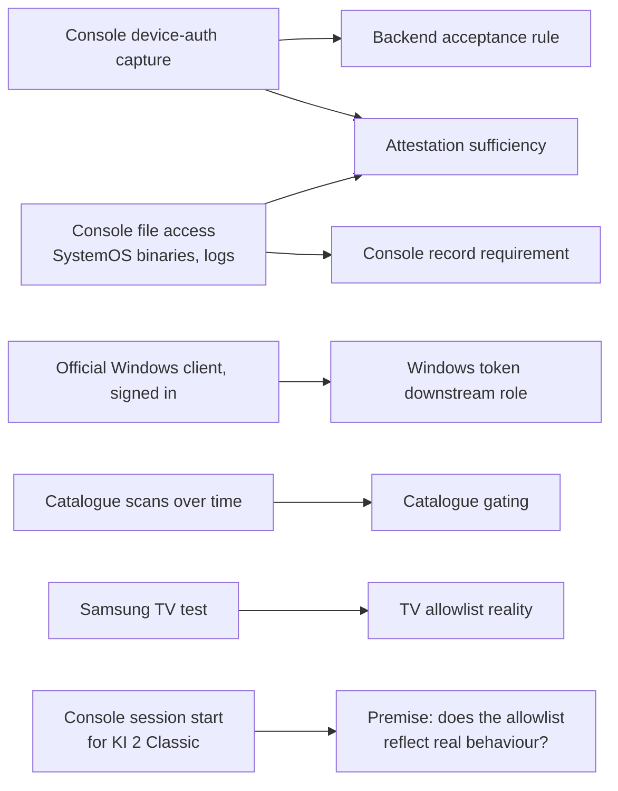

# Research roadmap — what must be found

This project is evidence-limited, not idea-limited. The question is not "what else can we
try" but "what artifact would settle which unknown".

## The unknowns

| ID | Unknown | Current state |
|---|---|---|
| U1 | What the backend actually validates for a console identity | Unknown |
| U2 | Whether a genuine attestation is sufficient by itself | Untested |
| U3 | Whether a console record must also be registered to the account | Untested |
| U4 | Whether the Windows RPS device token reaches XSTS/GSSV, and with what class | Unobserved |
| U5 | Whether catalogue filtering is per-account, per-offering or global | Partially mapped |
| U6 | Whether a real Samsung TV can start KI 2 Classic | Untested |

## What unlocks what

## Evidence table

| Evidence | Answers | How to obtain | Effort | Held? |
|---|---|---|---|---|
| Console `/device/authenticate` request/response metadata (field names, status, claim categories) | U1, U2 | Dev-mode or devkit console plus system-level tracing; possibly a proxied retail console | High | No |
| Console SystemOS binaries, logs, certificate metadata | U2, U3 | Dev-mode file access; a working exploit may go further | High | Partially public |
| A real console starting KI 2 Classic | Premise | Any Xbox with entitlement to the title | Low, if hardware exists | No |
| Official Windows client GSSV token at sign-in | U4 | Sign in as the entitled account; record status and claim categories only | Medium | No |
| Catalogue scans across days and accounts | U5 | Existing read-only tooling | Low | Partially |
| Samsung TV run of KI 2 Classic | U6 | A TV owner | Low, if hardware exists | No |

## Ranked by value per effort

1. **A console you already own starting KI 2 Classic.** Cheapest possible check of whether the
   allowlist reflects reality. Requires no tracing, no keys, no exploits.
2. **Dev-mode console (or devkit) with system-level tracing.** The realistic path to U1/U2:
   does the console expose `/device/authenticate`, what does it carry, and what does the
   server return.
3. **Official Windows client sign-in as the entitled account.** Closes U4 and costs only an
   interactive login. It cannot produce a console class, but it removes the last unobserved
   step on the PC side.
4. **Samsung TV test.** Narrow: KI 2 Classic only. GTA VI does not allow `SAMSUNGTV`.
5. **Console file access beyond dev mode.** Highest ceiling, lowest feasibility, and the most
   legally fraught. Treated as untested, not recommended.

## What each hardware route gives

| Access | Can observe | Cannot do |
|---|---|---|
| Retail console, normal use | Whether a title starts; timings; user-facing errors | System-level traffic internals |
| Retail console + network proxy | Connection pattern (hosts, timing); TLS payload remains encrypted | Read the device-auth body |
| Dev mode | App-level HTTP via developer tooling; system logs depending on build | Guaranteed SystemOS auth visibility |
| Devkit | Deeper tracing than retail dev mode | Make the server trust a non-console |
| Exploited console | Potentially SystemOS files, logs and binaries | Guaranteed certificate or key extraction |
| Samsung TV | Whether the TV starts KI 2 Classic | Anything for GTA VI |

**Nothing in this table lets a PC inherit the console's identity.** The console is a
*measurement instrument*, not a source of reusable credentials. Any capture must be
metadata-only by project policy.

## Non-hardware work that still matters

- Catalogue drift monitoring (U5).
- Public-source review of console provider exports and published analyses.
- A precise write-up of the RPS/JWE boundary (why the Windows token cannot be classified
  client-side).
- Reproducing existing experiments on a second account, to separate account quirks from
  service behaviour.

## What we do not need

- **Game assets or executables.** They do not touch device trust. See
  [game-executables.md](game-executables.md).
- Another header sweep. Three hundred variants produced one result: no.
- More `device.auth` device-type strings without a new hypothesis.
- Console purchases made only to re-test a gate we already mapped.

## Definition of done

A reproducible method satisfying all four
[completion criteria](current-status.md#completion-criteria), documented without publishing
credentials or proprietary material. Until then, every result is a step, not a success.
